<div align="center">

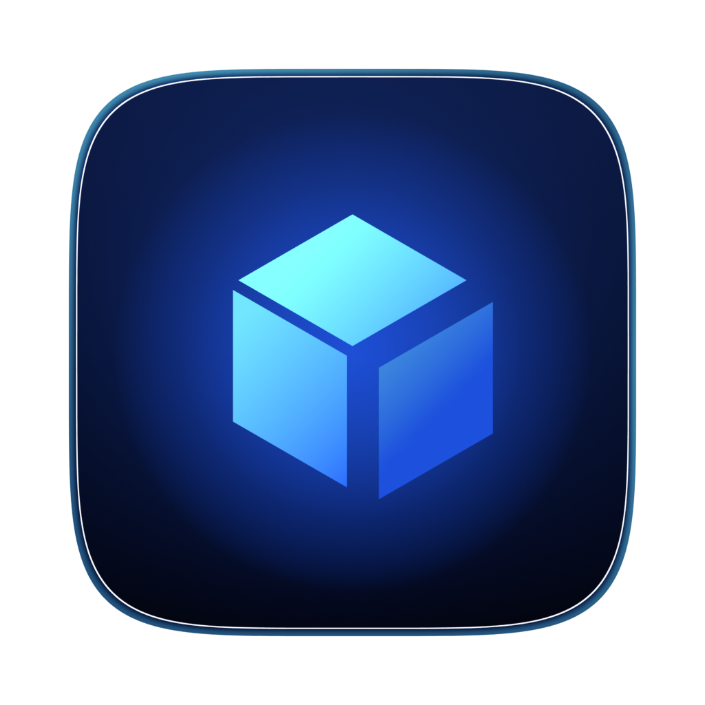

# IP SHIFT

**Ask your router for a fresh local IP with one button, then see exactly what happened inside a real-time 3D scene.**

Native macOS app (Swift) · Windows app (Electron) · React + Three.js + GSAP front end · Every 3D asset made in Blender

[](https://github.com/uhrichsam4/ip-shift/releases/latest/download/IP-SHIFT-1.0.0-macOS-universal.dmg)
[](https://github.com/uhrichsam4/ip-shift/releases/latest/download/IP-SHIFT-Setup-1.0.0-Windows-x64.exe)
[](https://github.com/uhrichsam4/ip-shift/releases/latest/download/IP-SHIFT-Launch-Film-1080p.mp4)
[](LICENSE)

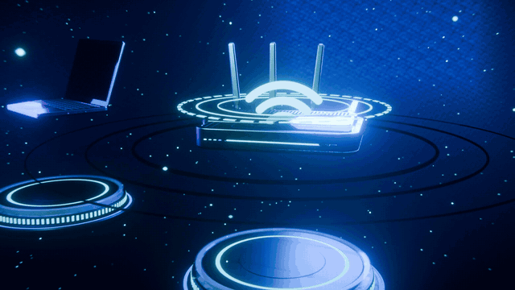

</div>

---

## Download

| Platform | File | Notes |
|---|---|---|
| **macOS 14+** (Apple silicon and Intel) | [IP-SHIFT-1.0.0-macOS-universal.dmg](https://github.com/uhrichsam4/ip-shift/releases/latest/download/IP-SHIFT-1.0.0-macOS-universal.dmg) | Open the DMG and drag to Applications. First launch: see [Opening on macOS](#opening-on-macos). |
| **Windows 10/11** (x64) | [IP-SHIFT-Setup-1.0.0-Windows-x64.exe](https://github.com/uhrichsam4/ip-shift/releases/latest/download/IP-SHIFT-Setup-1.0.0-Windows-x64.exe) | Unsigned installer. SmartScreen: **More info → Run anyway**. |
| **Launch film** | [IP-SHIFT-Launch-Film-1080p.mp4](https://github.com/uhrichsam4/ip-shift/releases/latest/download/IP-SHIFT-Launch-Film-1080p.mp4) | 42 s, 1080p, rendered entirely in Blender with original sound design. |

All files are on the [Releases page](https://github.com/uhrichsam4/ip-shift/releases).

> [!IMPORTANT]
> **Honest by design.** IP SHIFT renews your device's DHCP lease, and can optionally reconnect Wi-Fi. Your **router** decides which address you get, and many routers give a device the same address every time. IP SHIFT shows whether the address *actually* changed, separately from whether the internet came back. It never spoofs MAC addresses and never uses VPNs or proxies. Your **public IP** comes from your ISP and is not affected.

---

## The experience

<p align="center">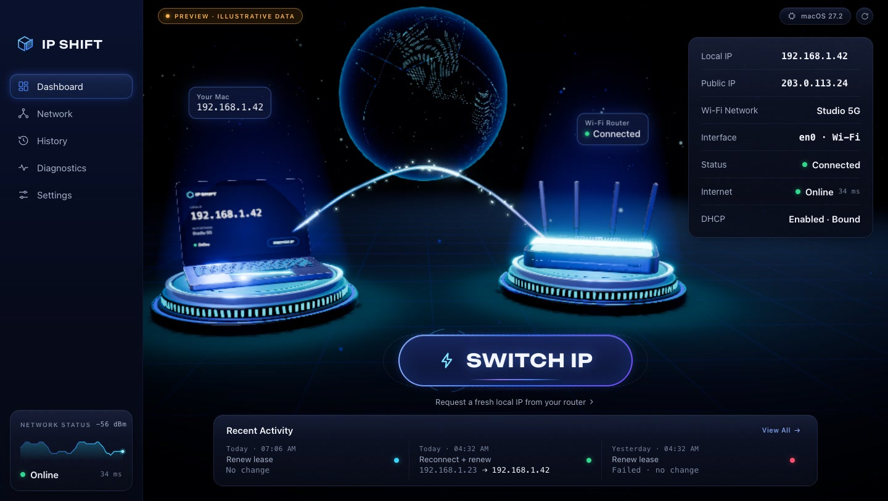</p>

The idle scene is always alive. A Blender-modelled router and laptop float on lit pedestals, joined by a flowing energy stream, with a dotted holographic Earth behind them and aurora ribbons in the sky. The glass panels show your real network data.

Press **SWITCH IP** and the camera takes over. Each stage is driven only by real events reported by the operating system:

| 1 · Initialise | 2 · Wi-Fi / DHCP | 3 · Results |
|---|---|---|
| 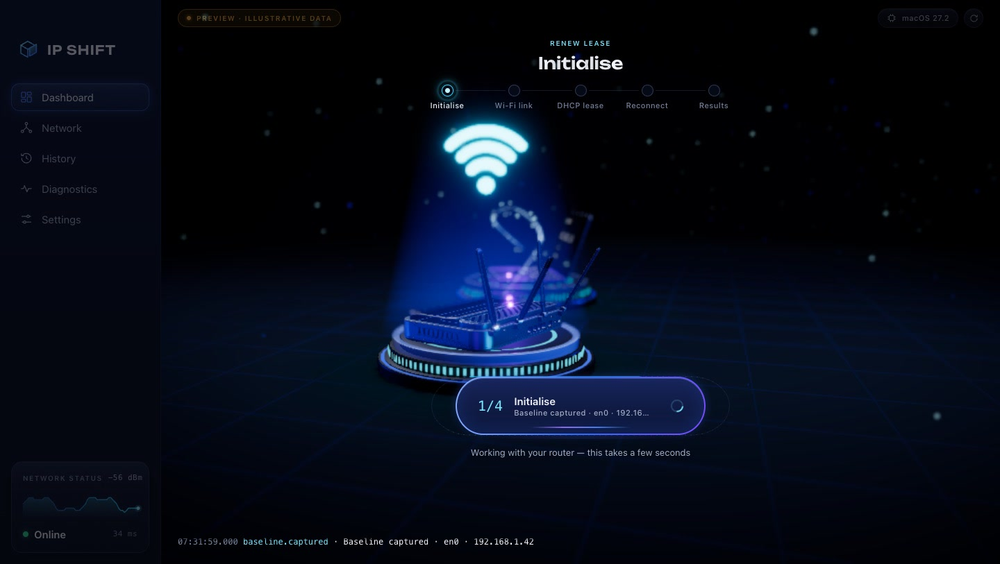 | 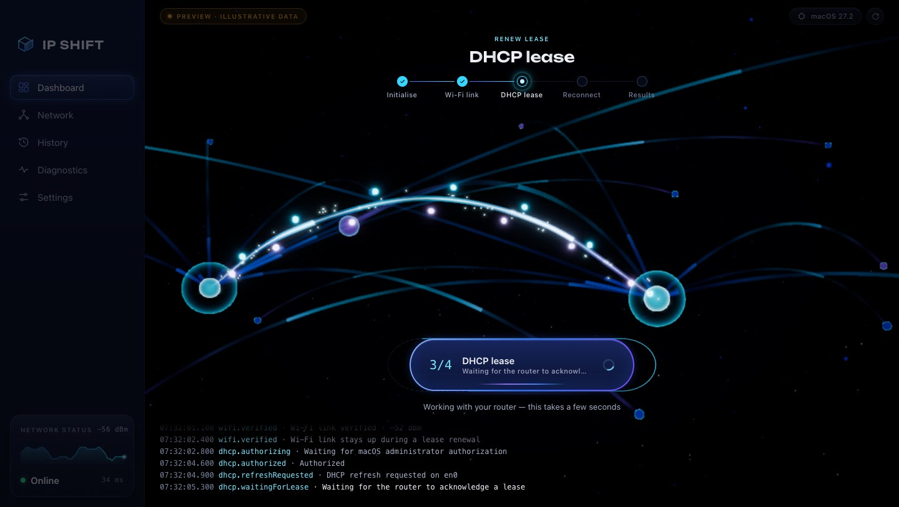 | 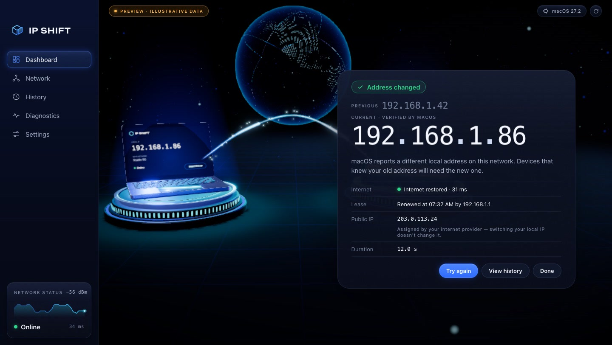 |
| The router isolates, its LEDs ramp up, and a holographic Wi-Fi symbol rises while the baseline (IP, lease, router) is captured. | The camera warps into a network space. Packets loop while the real lease request is pending, and a final ACK lands only when the OS confirms a new lease. | Previous and current addresses, as read back from the OS. Internet status, lease details and the ISP note are shown separately. |

| Network | History | Settings · Graphics |
|---|---|---|
| 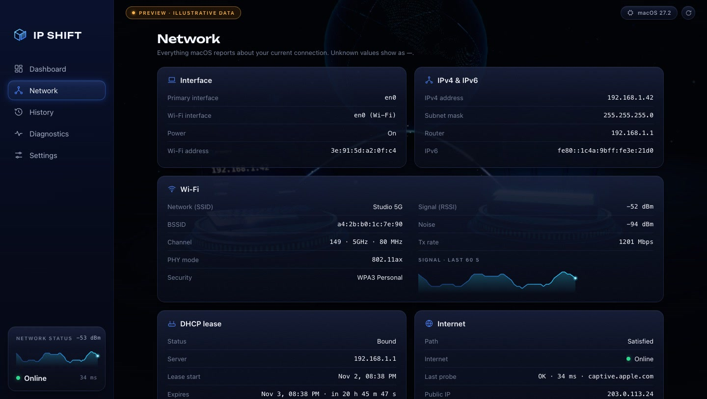 | 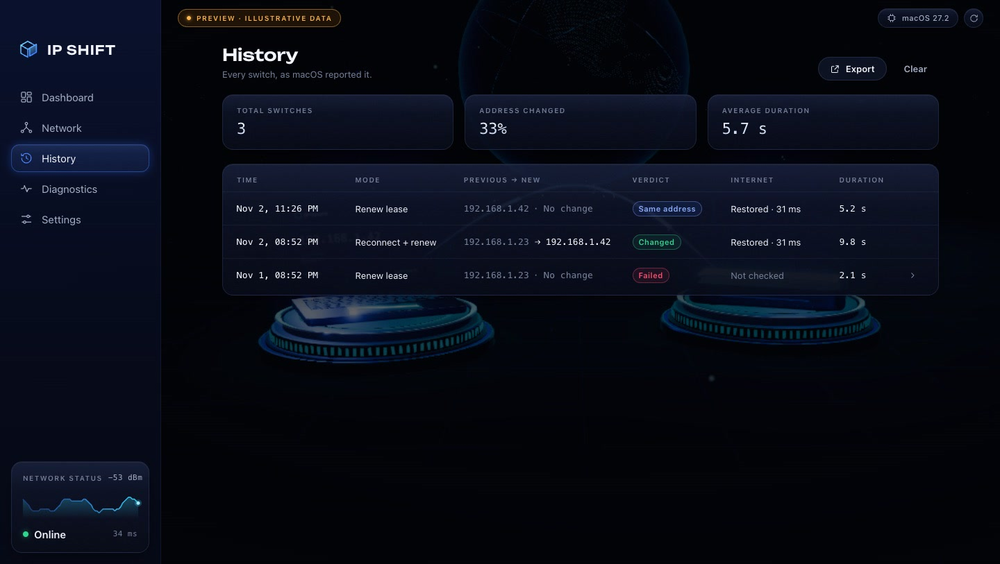 | 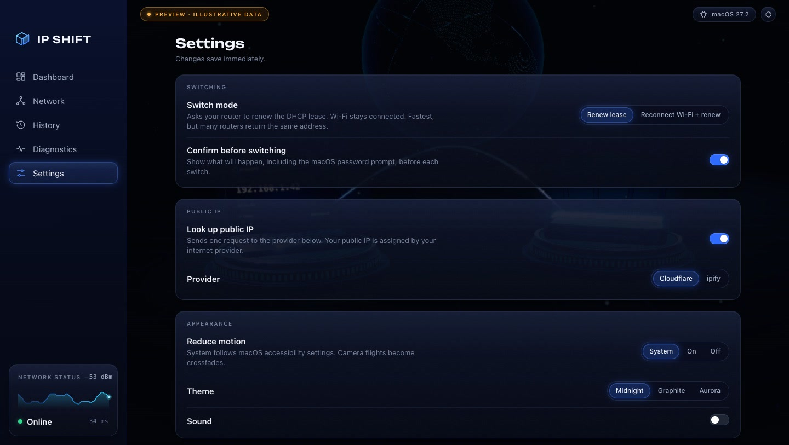 |

<sub>Screenshots come from the app's preview mode and use <b>illustrative data</b>. The badge in the corner says so. They contain no real network information.</sub>

<details>
<summary><b>Windows version</b></summary>
<p>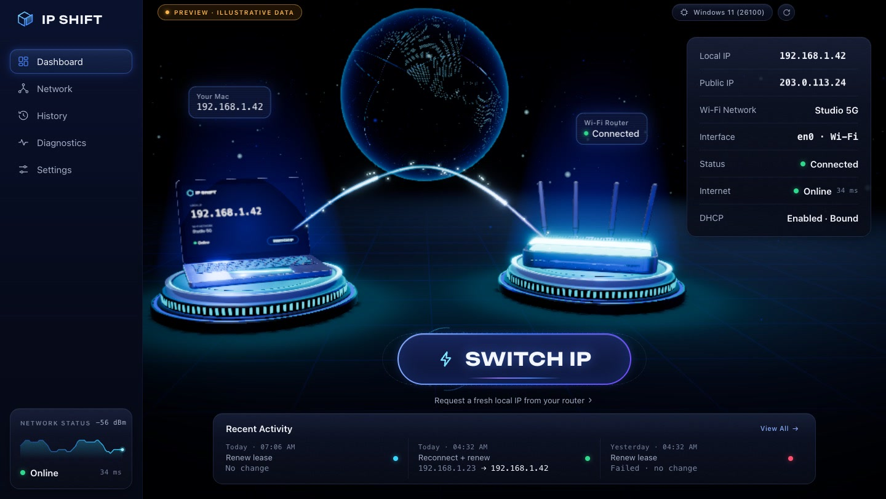</p>
Same experience, adapted for Windows: native caption buttons, Ctrl shortcuts and Windows wording.
</details>

---

## Features

**Networking (real, not simulated)**
- Detects the actual Wi-Fi interface and never assumes `en0`. Shows local IPv4, subnet, router, DNS, IPv6, DHCP server, lease start and expiry (with a live countdown), Wi-Fi network name, BSSID, channel, band, width, PHY, security, RSSI, noise and Tx rate with a live sparkline.
- **Renew lease** (default):
  - macOS: Authorization Services (the standard macOS admin prompt), then SystemConfiguration's `SCNetworkInterfaceForceConfigurationRefresh`. This is the same mechanism as System Settings' "Renew DHCP Lease".
  - Windows: IP Helper `IpRenewAddress`, offering a UAC restart only if Windows refuses.
- **Reconnect Wi-Fi + renew** (macOS): turns Wi-Fi off and on with CoreWLAN, waits for the rejoin and the new lease, and **always** turns Wi-Fi back on, even if a step fails or you quit mid-switch.
- A separate internet check (Apple captive probe on macOS, Microsoft NCSI on Windows) and an optional public-IP lookup (Cloudflare or ipify).
- Local history, diagnostics (interface, radio, association, IPv4, lease, router ping, DNS, internet, public IP, location) and exportable reports.

**Cinematic 3D**
- Router, laptop, pedestals, holo kit, dotted Earth globe, light ribbons, a studio HDRI and the app icon, all built with reproducible Blender Python scripts (`blender/scripts/`).
- A staged camera choreography for every operation phase: orbit, warp into a network space, packet flow, ACK landing, warp out, results.
- A GSAP motion system with custom eases, Flip transitions, staggered entrances, an odometer IP roll, and button hover, press and ripple states.

**Graphics settings, built for 120 fps**
- Presets (Auto, Low, Balanced, High, Ultra, Custom) plus 16 options: anti-aliasing (FXAA, SMAA, MSAA up to 8× where supported), render scale, frame-rate cap, shadows, screen-space AO, planar reflections, bloom, depth of field, volumetrics, particles, texture filtering, film effects, tone mapping and an FPS counter.
- WebGL has no hardware ray tracing, so reflections are planar mirrors and AO is screen-space. The settings say so.

**Accessibility**
- Full keyboard control (⌘/Ctrl 1–5, ⌘/Ctrl R, ⌘/Ctrl ↩, Esc).
- A live region announces stages and results.
- Reduced motion follows the OS setting: camera flights become crossfades.
- Contrast ≥ 4.5:1 for text.

---

## How SWITCH IP works

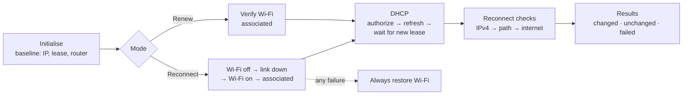

- Every visual phase is keyed to a phase code the native engine emits only after the real event is observed (`dhcp.leaseAcknowledged`, `reconnect.internetVerified`, …).
- A failed step emits `<stage>.failed`, never a success animation.
- The outcome compares IPs read back from the OS: *changed*, *same address reassigned*, *failed* or *cancelled*.

---

## Privacy and security

- **No accounts, no analytics, no telemetry.** History and settings stay on your device (`~/Library/Application Support/IP SHIFT/` or `%APPDATA%\IP SHIFT\`).
- **Network requests:** the internet check (captive.apple.com or msftconnecttest.com) and, if enabled, one public-IP lookup (Cloudflare or ipify). You can turn the public-IP lookup off.
- **No shell commands.** All networking goes through OS APIs (SystemConfiguration, CoreWLAN, Authorization Services; IP Helper and WLAN API on Windows). The only child process on macOS is `/sbin/ping` with a validated IPv4 argument array.
- **Locked-down web layer:**
  - The UI is served from a custom scheme with a strict CSP.
  - Navigation is locked.
  - The native bridge accepts allow-listed commands from its own origin only, with validated arguments.
- **Permissions:**
  - An admin prompt for lease renewal (macOS always; Windows only if required).
  - Optional Location access, because both OSes hide Wi-Fi network names without it. Location is used only for that and is never stored or sent.

---

## Performance

Measured with the built-in frame-time benchmark in the native macOS window (M4 Pro, 120 Hz):

| Preset | Avg fps | p95 | p99 |
|---|---|---|---|
| Low | 119.6 | 10 ms | 11 ms |
| **Balanced** (default via Auto) | **120.0** | 9 ms | 10 ms |
| High | 119.8 | 9 ms | 10 ms |
| Ultra | 115.8 | 9 ms | 10 ms |
| Balanced, during a switch | 115.1 | 10 ms | 15 ms |

What made 120 fps possible:
- turning off WebKit's default 60 fps cap on ProMotion displays
- no live backdrop blur over the canvas
- unlit floor shaders
- composited-only UI animation
- quality tiers with auto-tuning

Run it yourself:

```bash
IPSHIFT_BENCH=1 "/Applications/IP SHIFT.app/Contents/MacOS/IPShift"
```

---

## Opening on macOS

The public build is ad-hoc signed and not notarized. The first time, macOS will block it:

1. Open **System Settings → Privacy & Security**, scroll down, and click **Open Anyway** next to IP SHIFT.
2. Or, if you trust the download, run:

```bash
xattr -dr com.apple.quarantine "/Applications/IP SHIFT.app"
```

## Opening on Windows

The installer is unsigned. In the SmartScreen dialog, click **More info → Run anyway**.
- On Windows 11 24H2 and later, allow **Settings → Privacy & security → Location → Let desktop apps access your location** if you want the Wi-Fi network name shown.
- If Windows requires administrator rights for lease renewal, IP SHIFT asks before restarting elevated.

---

## Build from source

Requirements:

| Target | Needs |
|---|---|
| macOS | Xcode 16+ (Swift 6), Node 20+ with pnpm |
| Windows | Node + pnpm (builds the installer from macOS or Windows) |
| Assets | Blender 5.1+ |
| Film | Blender 5.1+ and ffmpeg |

```bash
pnpm --dir web install && pnpm --dir web build
```

```bash
IPSHIFT_UNIVERSAL=1 scripts/build-app.sh && scripts/make-dmg.sh
```

```bash
pnpm --dir windows install && bash scripts/build-windows.sh
```

```bash
"/Applications/Blender.app/Contents/MacOS/Blender" -b --factory-startup -P blender/scripts/build_all.py
```

- Development with hot reload: `scripts/dev.sh` (macOS) or `pnpm --dir web dev` (browser preview with illustrative data).
- Tests: `swift test --package-path native`.
- Launch film pipeline: [film/README.md](film/README.md).

---

## Architecture

```
native/    SwiftPM: IPShiftCore (networking engine), IPShiftApp (AppKit + WKWebView host), ipshift-cli, tests
windows/   Electron shell (app:// protocol, IPC) + Win32 backend via koffi (iphlpapi, wlanapi)
web/       React 19 + TypeScript + Vite: bridge client, zustand store, UI, GSAP motion, R3F scene
blender/   Reproducible asset scripts → GLB (Draco, WebP), HDRI, icon
film/      Launch film: Blender scene, synthesized audio, FFmpeg assembly
```

- One bridge contract, [`web/src/bridge/protocol.ts`](web/src/bridge/protocol.ts), is shared by the Swift engine, the Windows backend and the UI.
- Deep dives: [ARCHITECTURE.md](ARCHITECTURE.md), [DESIGN.md](DESIGN.md) (the full design system: tokens, motion, camera, components), [TASKS.md](TASKS.md) (status, measurements and known issues) and [docs/RESEARCH.md](docs/RESEARCH.md).

---

## Known limitations

- DHCP renewal **does not guarantee** a different address. The router decides.
- **Windows:**
  - Reconnect mode and the router ping are not implemented yet.
  - The Windows build has not been tested on real hardware yet.
- The macOS build is not notarized, and the Windows installer is not code-signed.
- The launch film is 1080p at 30 fps.

## Credits and license

- Code, 3D assets, HDRI, film and sound design: original work for this project, released under the [MIT License](LICENSE).
- [Unbounded](https://github.com/googlefonts/unbounded) typeface: SIL Open Font License ([blender/fonts/OFL.txt](blender/fonts/OFL.txt)).
- Built with Swift, React, Three.js / React Three Fiber, GSAP, Electron, koffi and Blender.
